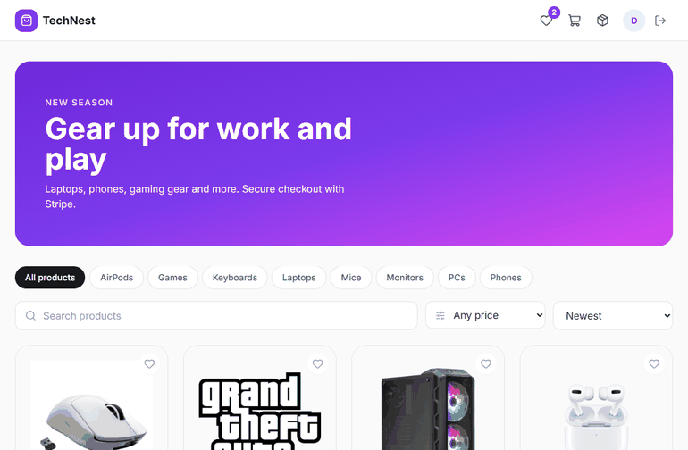
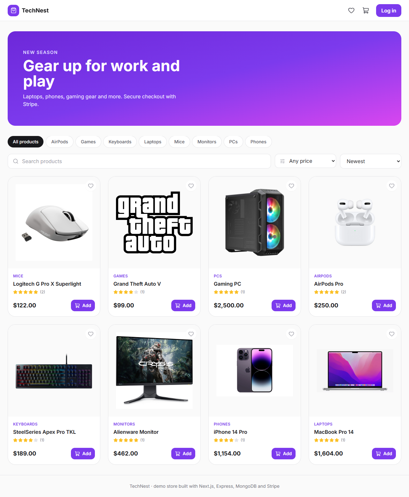
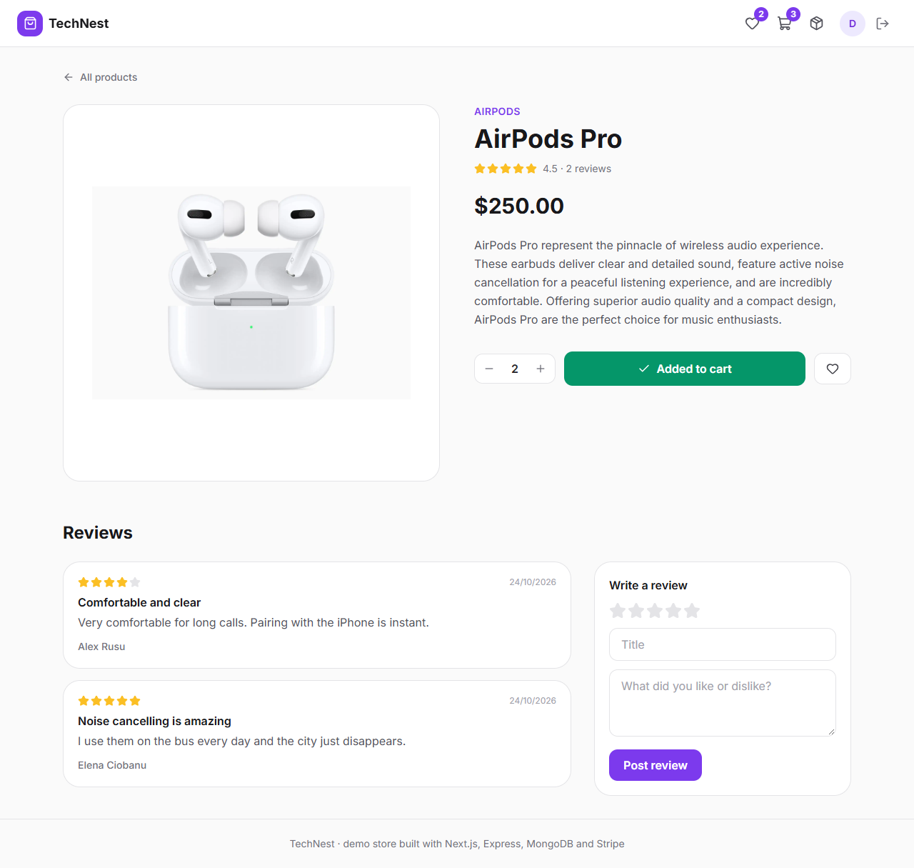
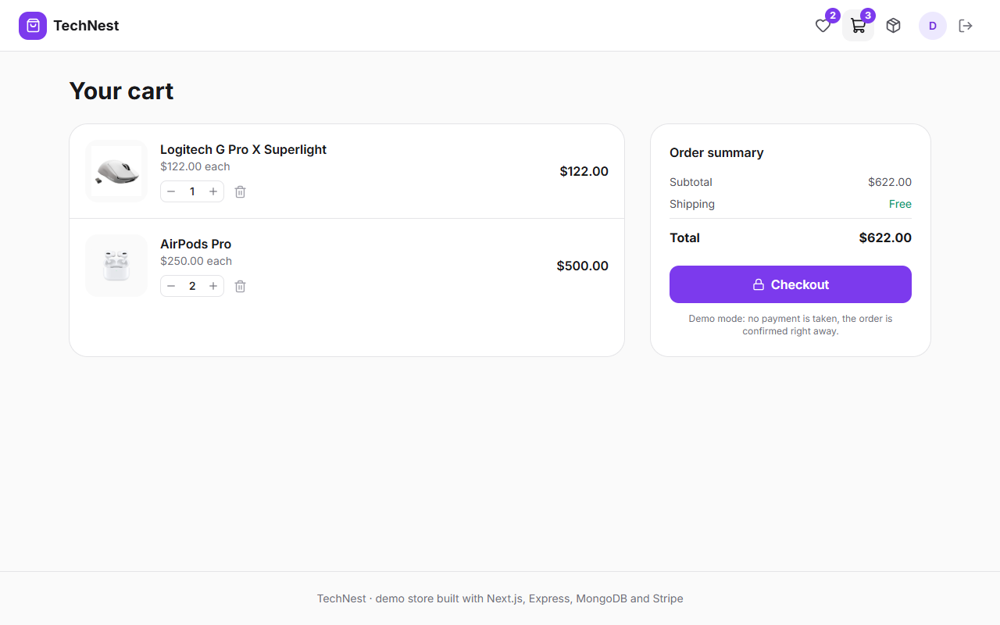
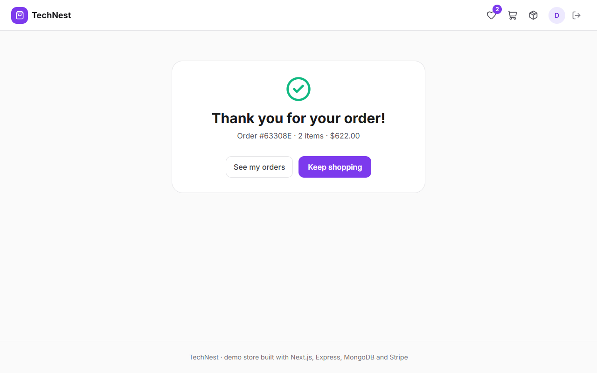
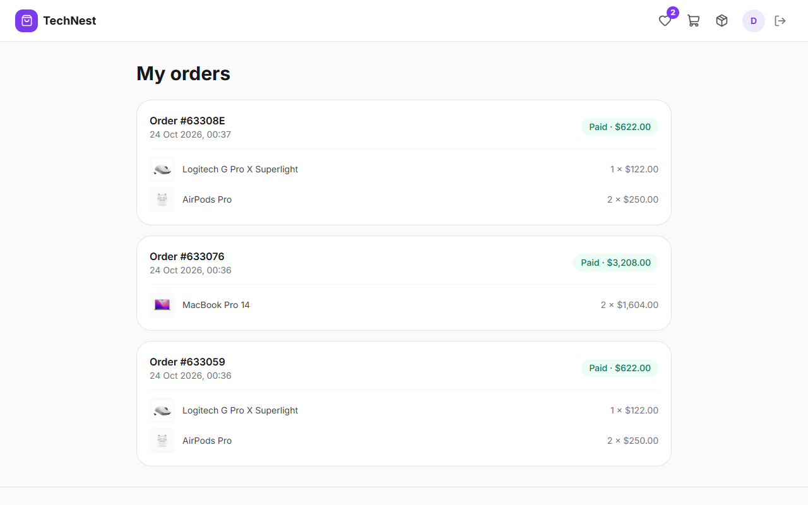
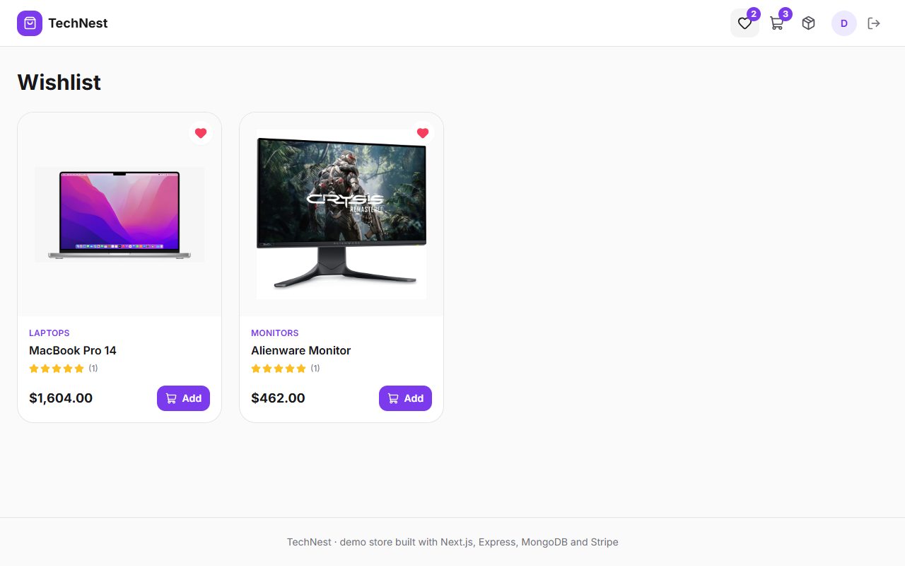
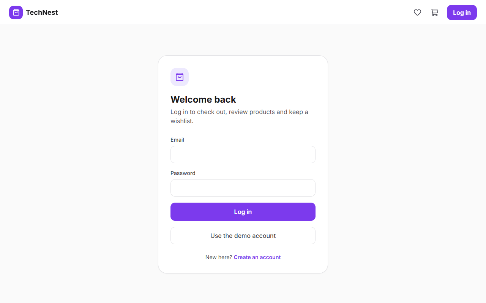
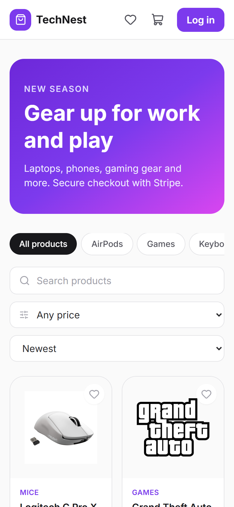
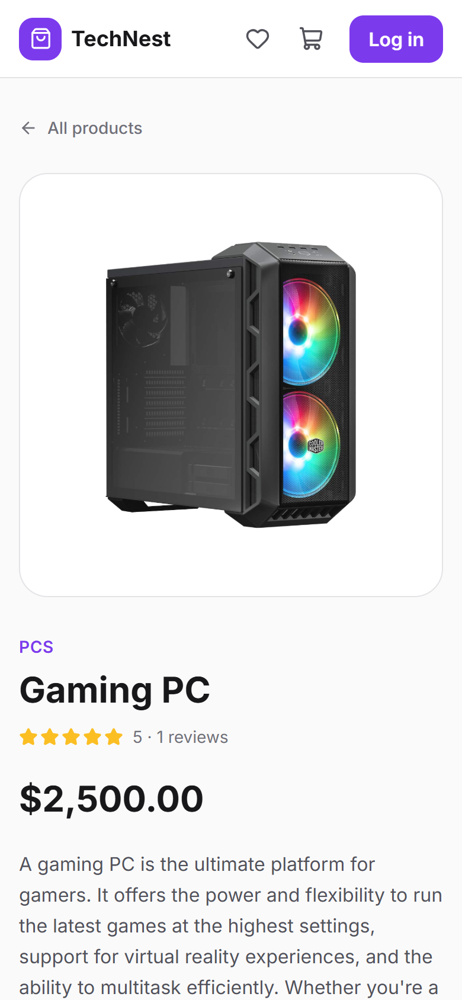

# TechNest: e-commerce store with Next.js, Express, MongoDB and Stripe

An online tech store where you can browse and filter products, keep a wishlist, write reviews and check out with Stripe. Prices are always calculated on the server, and every order is saved to your account.



*Filtering by category, adding a laptop to the cart, checking out and seeing the order in "My orders".*



| Product and reviews | Cart |
|---|---|
|  |  |

| Order confirmed | My orders | Wishlist |
|---|---|---|
|  |  |  |

| Log in | Phone: shop | Phone: product |
|---|---|---|
|  |  |  |

## Features

- **Shop** with category filters, search, price ranges and sorting (newest, price, best rated). All filters run in one MongoDB query.
- **Product page** with quantity picker, wishlist button and customer reviews.
- **Reviews** with a 1 to 5 star rating. Each user can review a product once (a new review replaces the old one), and the product's average rating updates automatically.
- **Cart** saved in the browser, with quantities and a live total.
- **Checkout with Stripe Checkout** (test mode). The browser only sends product ids and quantities; the server reads the prices from the database, creates the order and the Stripe session, and the success page asks Stripe whether the payment went through.
- **Demo mode**: without a Stripe key, checkout confirms the order right away, so the whole flow can be tried without a Stripe account.
- **Wishlist** stored per account, so it follows you to any device.
- **Order history** under "My orders".
- **Sign up and log in** with JWT authentication and bcrypt-hashed passwords.
- **Responsive layout** for phones and desktops.

## Tech stack

| Layer | Technologies |
|---|---|
| Frontend | Next.js 14 (App Router), React 18, Tailwind CSS, Axios, Lucide icons |
| Backend | Node.js, Express, Mongoose |
| Database | MongoDB (Atlas or local) |
| Payments | Stripe Checkout |
| Auth | JSON Web Tokens, bcrypt |
| Tests | Node test runner, Supertest, mongodb-memory-server |

## How checkout works

```
Cart (browser)  ──  [{ productId, quantity }]  ──►  POST /api/orders/checkout
                                                        │ reads prices from MongoDB
                                                        │ saves the order (pending)
                                                        ▼
                                                Stripe Checkout session ──► Stripe payment page
                                                                                  │
Success page  ◄──────────────  redirect with session_id  ◄────────────────────────┘
      │
      └──►  POST /api/orders/confirm  ──►  asks Stripe if it was paid  ──►  order marked "paid"
```

### API

| Method | Endpoint | Auth | Description |
|---|---|---|---|
| POST | `/api/auth/sign-up`, `/api/auth/login` | | Create an account or log in, returns token and user |
| GET | `/api/auth/me` | ✓ | The logged-in user |
| GET | `/api/products?category=&search=&minPrice=&maxPrice=&sort=` | | Products with filters |
| GET | `/api/products/categories` | | All categories |
| GET | `/api/products/:id` | | One product |
| GET | `/api/products/:id/reviews` | | Reviews for a product |
| POST | `/api/products/:id/reviews` | ✓ | Write or update your review |
| GET / PUT / DELETE | `/api/wishlist`, `/api/wishlist/:productId` | ✓ | Read, add to or remove from your wishlist |
| POST | `/api/orders/checkout` | ✓ | Create an order and a Stripe session |
| POST | `/api/orders/confirm` | ✓ | Confirm the payment after Stripe redirects back |
| GET | `/api/orders` | ✓ | My paid orders |

## Getting started

Requirements: Node.js 18+ and a MongoDB database (a free [MongoDB Atlas](https://www.mongodb.com/atlas) cluster works, or MongoDB installed locally). A Stripe account is optional.

**1. Backend**

```bash
cd server
npm install
copy .env.example .env      # macOS/Linux: cp .env.example .env
```

Fill in `MONGODB_URI` and `JWT_SECRET`. To use real Stripe test payments, also add your test key (`sk_test_...`) from the [Stripe dashboard](https://dashboard.stripe.com/test/apikeys) as `STRIPE_SECRET_KEY`. Then:

```bash
npm run seed                # demo accounts, products and reviews
npm run dev                 # http://localhost:8000
```

**2. Frontend** (in a second terminal)

```bash
cd client
npm install
npm run dev                 # http://localhost:3000
```

Log in with **demo@shop.app** / **ShopDemo123!** or click "Use the demo account". With Stripe enabled, pay with the test card **4242 4242 4242 4242**, any future date and any CVC.

**Configuration**

| Variable | Where | Default | Used for |
|---|---|---|---|
| `MONGODB_URI` | server | (required) | MongoDB connection string |
| `JWT_SECRET` | server | (required) | Signs the login tokens |
| `PORT` | server | `8000` | API port |
| `CLIENT_URL` | server | `http://localhost:3000` | CORS and Stripe redirect address |
| `STRIPE_SECRET_KEY` | server | empty (demo mode) | Stripe test key |
| `NEXT_PUBLIC_API_URL` | client | `http://localhost:8000` | API address |

**Tests**

```bash
cd server
npm test
```

The 10 API tests run against an in-memory MongoDB. They cover auth (including fake tokens), filters, one-review-per-user and the average rating, separate wishlists per user, and a checkout that ignores prices sent by the browser.

## Project structure

```
client/
  app/            pages: shop (/), products/[id], cart, wishlist, orders,
                  checkout/success, login, sign-up
  components/     Navbar, ProductCard, Stars, AuthCard, EmptyState, Providers
  lib/            API client and the store context (session, cart, wishlist)
server/
  index.js        connects to MongoDB and starts the server
  app.js          Express app and routes
  routes/         auth, products (+ reviews), wishlist, orders (+ Stripe)
  models/         User, Product, Review, Order
  middleware/     JWT check
  seed/           demo products and seed script
  tests/          API tests
```

## What I would add next

- Stripe webhooks, so orders are confirmed even if the customer closes the tab
- Stock tracking and an admin page for products
- Saved carts for logged-in users
- Pagination and more filters

Product images are linked from the manufacturers and stores that published them. The Grand Theft Auto logo is from [Wikimedia Commons](https://commons.wikimedia.org/wiki/File:Grand_Theft_Auto_logo_series.svg).
